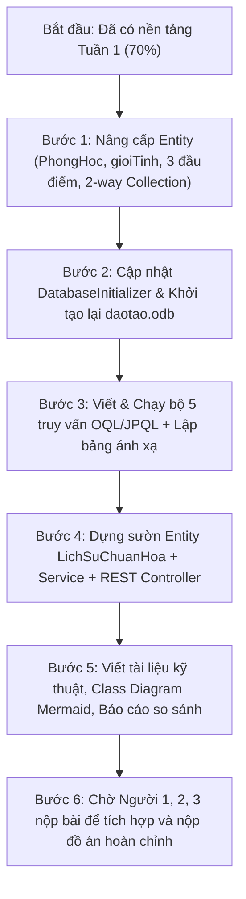

# KẾ HOẠCH CHI TIẾT THỰC HIỆN MỤC 4: CSDL HƯỚNG ĐỐI TƯỢNG (OBJECTDB)
**Dự án:** Hệ thống Quản lý Đào tạo Đại học & Công cụ Chuẩn hóa CSDL (Đề tài 10)  
**Phân công thực hiện:** Người 4 (Vinh)  
**Tài liệu căn cứ:**
- [Công việc.docx](file:///d:/CSDL_NC/Công việc.docx) (Bảng phân công chi tiết 4 thành viên)
- [goi-sv-huong-dan-cac-de-tai-csdl-nang-cao.md](file:///d:/CSDL_NC/goi-sv-huong-dan-cac-de-tai-csdl-nang-cao.md) (Hướng dẫn chung đồ án CSDL Nâng cao)

---

## I. TỔNG QUAN PHÂN CHIA VÀ TRẠNG THÁI CÁC TASK

Bảng phân loại dưới đây chia toàn bộ yêu cầu của Mục 4 thành 5 nhóm Task, chỉ rõ:
1. **ĐÃ HOÀN THÀNH:** Các phần đã code, cấu hình và chạy thử thành công ở Tuần 1.
2. **CẦN LÀM TIẾP (TỰ CHỦ):** Các phần thuộc nghiệp vụ Mục 4 cần bổ sung/nâng cấp để đạt 100% yêu cầu.
3. **CHỜ NGƯỜI 1, 2, 3 (LÀM SƯỜN TRƯỚC):** Các phần tích hợp liên quan đến thành viên khác. Vinh xây dựng sẵn Entity, Service, Controller REST API (Scaffolding); khi các bạn nộp code/thuật toán/giao diện chỉ cần ghép nối trong 5 phút.

| Mã Task | Tên Hạng Mục / Nội Dung | Trạng Thái Hiện Tại | Người Phối Hợp | Hành Động Kế Tiếp |
| :--- | :--- | :---: | :---: | :--- |
| **TASK 1** | **Thiết kế Mô hình Đối tượng (Entities & OOP)** | **ĐÃ LÀM 70%** | Độc lập (Người 4) | Bổ sung `PhongHoc`, `gioiTinh`, 3 cột điểm, quan hệ 2 chiều |
| 1.1 | Lớp cha `Nguoi` (`@MappedSuperclass` / `@Entity`) | *Đã làm* | - | Thêm thuộc tính `gioiTinh` |
| 1.2 | Lớp con kế thừa: `SinhVien`, `GiangVien` | *Đã làm 100%* | - | Giữ nguyên, kế thừa `@Entity` |
| 1.3 | Lớp độc lập: `HocPhan`, `LopHocPhan` | *Đã làm 80%* | - | Thêm thuộc tính tập hợp 2 chiều |
| 1.4 | Lớp độc lập mới: `PhongHoc` | *Chưa làm* | - | Tạo mới Entity `PhongHoc` (`maPhong`, `toaNha`, `sucChua`) |
| 1.5 | Lớp liên kết: `DangKyMon` (`DangKy`) | *Đã làm 60%* | - | Thêm `diemChuyenCan`, `diemGiuaKy`, `diemCuoiKy` + hàm tính điểm |
| 1.6 | Phương thức xử lý nghiệp vụ nội tại trong Entity | *Đã làm 100%* | - | `kiemTraTrungLich`, `tinhDiemTrungBinh`, `tongTinChiTichLuy`, `xepLoaiHocLuc` |
| **TASK 2** | **Cài đặt, Cấu hình & Khởi tạo CSDL ObjectDB** | **ĐÃ LÀM 85%** | Độc lập (Người 4) | Bổ sung dữ liệu phòng học & 3 đầu điểm |
| 2.1 | Cài đặt Maven Wrapper & tích hợp `objectdb-2.9.5.jar` | *Đã làm 100%* | - | Đã build và chạy thành công |
| 2.2 | Script sinh dữ liệu mẫu (`daotao.odb`) bằng Transaction | *Đã làm 80%* | - | Cập nhật dữ liệu mẫu có gắn `PhongHoc` và 3 đầu điểm |
| 2.3 | Kịch bản Transaction Commit thành công & Rollback khi lỗi | *Đã làm 100%* | - | Đã kiểm thử trong `Main.java` |
| **TASK 3** | **Bộ 4 Truy vấn OQL / JPQL Chuyên sâu** | **ĐÃ LÀM 40%** | Độc lập (Người 4) | Chuẩn hóa 4 câu đúng yêu cầu + Bảng đối chiếu OQL - JPQL |
| 3.1 | Câu 1 - Đa hình (Polymorphism Query) trên `Nguoi` | *Cần viết mới* | - | Quét bảng cha `Nguoi` lấy cả `SinhVien` và `GiangVien` |
| 3.2 | Câu 2 - Điều hướng đường dẫn (Path Navigation không JOIN) | *Đã làm* | - | `SELECT d.sinhVien.hoTen FROM DangKy d WHERE d.lopHocPhan.phongHoc.toaNha = 'A'` |
| 3.3 | Câu 3 - Thao tác trên tập hợp (Collection Size / Empty) | *Cần viết mới* | - | Lọc các lớp học phần có số lượng đăng ký vượt ngưỡng hoặc kiểm tra rỗng |
| 3.4 | Câu 4 - Lọc nâng cao theo điều kiện nghiệp vụ đào tạo | *Đã làm* | - | Tìm sinh viên đạt điểm giỏi ở học phần cụ thể |
| 3.5 | Lập bảng đối chiếu cú pháp OQL lý thuyết $\leftrightarrow$ JPQL ObjectDB | *Chưa làm* | - | Viết tài liệu đối chiếu theo yêu cầu của thầy |
| **TASK 4** | **Lưu trữ Lịch sử Chuẩn hóa (Tích hợp Người 2 & 3)** | **LÀM SƯỜN TRƯỚC** | **Chờ Người 2 & 3** | Viết Entity + Service + REST Controller sẵn sàng |
| 4.1 | Thiết kế Entity `LichSuChuanHoa` trong ObjectDB | *Chưa làm* | - | Lưu OID, `thoiGianChay`, `tapThuocTinhDauVao`, `tapPhuThuocHam`, `loaiThuatToan`, `ketQuaTraVe` |
| 4.2 | Viết DAO/Service: `saveLichSu()` & `getAllLichSu()` | *Chưa làm* | - | Tự động mở transaction ObjectDB lưu log thuật toán |
| 4.3 | Xây dựng REST API Endpoint (`POST /api/history`, `GET /api/history`) | *Chưa làm* | Chờ Người 2 (gọi POST), Người 3 (gọi GET) | Viết sẵn Controller Spring Boot trả về JSON |
| 4.4 | Viết tài liệu hướng dẫn gọi API cho Người 2 và Người 3 | *Chưa làm* | Chờ Người 2 & 3 | Viết file `HUONG-DAN-TICH-HOP-API-LICHSU.md` |
| **TASK 5** | **Tài liệu Kỹ thuật, Class Diagram & Báo cáo So sánh** | **CHƯA LÀM** | Độc lập (Người 4) | Viết báo cáo hoàn chỉnh |
| 5.1 | Vẽ sơ đồ lớp đối tượng (UML Class Diagram bằng Mermaid) | *Chưa làm* | - | Thể hiện rõ OID, Kế thừa, Association, Multiplicity |
| 5.2 | Bài viết so sánh: OID vs PK/FK, Path Navigation vs SQL JOIN | *Chưa làm* | - | Phân tích ưu/nhược điểm khi lưu trữ dữ liệu phức tạp |
| 5.3 | So sánh ánh xạ quan hệ của Người 1 với hướng đối tượng của Người 4 | *Chờ Người 1* | Chờ CSDL Người 1 | Lập bảng đối chiếu thực thể quan hệ $\leftrightarrow$ Lớp đối tượng |

---

## II. KẾ HOẠCH TRIỂN KHAI CHI TIẾT TỪNG TASK

### Task 1: Hoàn thiện Mô hình Đối tượng (Entities & OOP)
* **Mục tiêu:** Đáp ứng đầy đủ 100% các yêu cầu mô hình hóa của Mục 4 trong `Công việc.docx`.
* **Chi tiết thay đổi:**
  1. [Nguoi.java](file:///d:/CSDL_NC/co_so_du_lieu_nang_cao/db-normalization-tool/src/main/java/com/doan10/db_normalization_tool/entity/Nguoi.java): Thêm trường `gioiTinh` (Nam/Nữ).
  2. Tạo mới [PhongHoc.java](file:///d:/CSDL_NC/co_so_du_lieu_nang_cao/db-normalization-tool/src/main/java/com/doan10/db_normalization_tool/entity/PhongHoc.java):
     ```java
     @Entity
     public class PhongHoc {
         @Id @GeneratedValue private long oid;
         private String maPhong;   // Ví dụ: A101, B204
         private String toaNha;    // Tòa A, Tòa B
         private int sucChua;      // Sức chứa tối đa (chỗ ngồi)
         // Getters, Setters, Constructor
     }
     ```
  3. Cập nhật [LopHocPhan.java](file:///d:/CSDL_NC/co_so_du_lieu_nang_cao/db-normalization-tool/src/main/java/com/doan10/db_normalization_tool/entity/LopHocPhan.java):
     - Thêm quan hệ tham chiếu trực tiếp: `private PhongHoc phongHoc;` (thay vì lưu `phongHocId` dạng foreign key).
     - Bổ sung quan hệ tập hợp 2 chiều: `private List<DangKy> dsDangKy = new ArrayList<>();`.
  4. Cập nhật [HocPhan.java](file:///d:/CSDL_NC/co_so_du_lieu_nang_cao/db-normalization-tool/src/main/java/com/doan10/db_normalization_tool/entity/HocPhan.java):
     - Bổ sung quan hệ tập hợp 2 chiều: `private List<LopHocPhan> dsLopHocPhan = new ArrayList<>();`.
  5. Cập nhật [DangKy.java](file:///d:/CSDL_NC/co_so_du_lieu_nang_cao/db-normalization-tool/src/main/java/com/doan10/db_normalization_tool/entity/DangKy.java):
     - Mở rộng cấu trúc điểm: `diemChuyenCan` (hệ số 0.1), `diemGiuaKy` (hệ số 0.3), `diemCuoiKy` (hệ số 0.6).
     - Thêm phương thức tự động tính: `tinhDiemTongKet() = diemChuyenCan * 0.1 + diemGiuaKy * 0.3 + diemCuoiKy * 0.6`.
     - Giữ phương thức kiểm tra đạt `isQuaMon() >= 4.0`.

---

### Task 2: Script Khởi tạo & Quản lý Transaction ObjectDB
* **Mục tiêu:** Tự động tạo cơ sở dữ liệu `daotao.odb` chuẩn mực với đầy đủ dữ liệu phong phú, kiểm tra tính ACID của Transaction.
* **Chi tiết thực hiện:**
  - Viết `DatabaseInitializer.java`:
    - Tạo danh sách `PhongHoc` (A101, A102, B201, C301...).
    - Tạo `GiangVien`, `SinhVien`, `HocPhan`, `LopHocPhan` (gán phòng học).
    - Tạo các bản ghi `DangKy` có điểm chi tiết 3 thành phần.
  - Kiểm thử 2 kịch bản Transaction:
    1. **Commit thành công:** Lưu toàn bộ cấu trúc đối tượng lồng nhau (Object Graph Persistence) chỉ trong 1 transaction duy nhất.
    2. **Rollback an toàn:** Giả lập lỗi trùng mã hoặc ngoại lệ nghiệp vụ $\rightarrow$ kiểm tra dữ liệu cũ không bị ảnh hưởng.

---

### Task 3: Bộ 4 Truy vấn OQL / JPQL Bắt buộc & Bảng Đối Chiếu
* **Mục tiêu:** Viết đúng 4 loại truy vấn đặc trưng của CSDL hướng đối tượng theo `Công việc.docx` và đáp ứng chuẩn đồ án.
* **Chi tiết 4 câu truy vấn:**
  1. **Truy vấn Đa hình (Polymorphism):**
     - OQL: `SELECT p FROM Nguoi p WHERE p.gioiTinh = 'Nữ'`
     - JPQL: `SELECT p FROM Nguoi p WHERE p.gioiTinh = 'Nữ'`
     - *Ý nghĩa:* Quét trực tiếp trên lớp cha `Nguoi`, kết quả trả về danh sách đối tượng hỗn hợp gồm cả `SinhVien` và `GiangVien` mà CSDL quan hệ không làm được trực tiếp nếu chia bảng riêng.
  2. **Truy vấn Điều hướng Đường dẫn (Path Navigation không JOIN):**
     - OQL: `SELECT d.sinhVien.hoTen, d.lopHocPhan.phongHoc.maPhong FROM DangKy d WHERE d.lopHocPhan.phongHoc.toaNha = 'A'`
     - JPQL: `SELECT d.sinhVien.hoTen, d.lopHocPhan.phongHoc.maPhong FROM DangKy d WHERE d.lopHocPhan.phongHoc.toaNha = 'A'`
     - *Ý nghĩa:* Truy vết qua 3 cấp đối tượng (`DangKy` $\rightarrow$ `LopHocPhan` $\rightarrow$ `PhongHoc`) bằng toán tử dấu chấm `.` mượt mà, loại bỏ hoàn toàn các cú pháp `INNER JOIN` rườm rà của SQL.
  3. **Truy vấn Thao tác trên Tập hợp (Collection Operation):**
     - OQL: `SELECT l FROM LopHocPhan l WHERE count(l.dsDangKy) >= 2`
     - JPQL: `SELECT l FROM LopHocPhan l WHERE SIZE(l.dsDangKy) >= 2`
     - *Ý nghĩa:* Thao tác trực tiếp trên thuộc tính tập hợp `List<DangKy>` lồng trong đối tượng `LopHocPhan`.
  4. **Truy vấn Lọc Nâng cao Nghiệp vụ (Advanced Business Filter):**
     - OQL: `SELECT d.sinhVien FROM DangKy d WHERE d.lopHocPhan.hocPhan.maHocPhan = 'CSDL01' AND d.diemTongKet >= 8.0`
     - JPQL: `SELECT d.sinhVien FROM DangKy d WHERE d.lopHocPhan.hocPhan.maHocPhan = 'CSDL01' AND (d.diemChuyenCan*0.1 + d.diemGiuaKy*0.3 + d.diemCuoiKy*0.6) >= 8.0`
     - *Ý nghĩa:* Tìm danh sách sinh viên đạt loại Giỏi/Xuất sắc ở một môn học chỉ định.
  5. **Bảng Đối Chiếu Cú pháp:**
     - Xây dựng bảng so sánh từng cú pháp giữa OQL lý thuyết (ODMG 3.0) và JPQL (ObjectDB JPA) để đưa vào báo cáo và slide bảo vệ.

---

### Task 4: Module Lưu trữ Lịch sử Chuẩn hóa (Làm Sườn Trước - Chờ Người 2 & 3)
* **Mục tiêu:** Cung cấp giải pháp lưu trữ lịch sử các lượt chạy thuật toán chuẩn hóa CSDL (Bao đóng, Phủ tối tiểu, Khóa, Dạng chuẩn, Phân rã 3NF/BCNF) bằng ObjectDB.
* **Lý do dùng ObjectDB:** Lịch sử chạy thuật toán có cấu trúc động (tập thuộc tính $U$, tập phụ thuộc hàm $F$, các bước phân rã theo cây...). Lưu bằng CSDL hướng đối tượng/Document trong ObjectDB linh hoạt hơn rất nhiều so với bảng quan hệ cứng nhắc.
* **Sườn code thực hiện trước:**
  1. Tạo Entity `LichSuChuanHoa.java`:
     ```java
     @Entity
     public class LichSuChuanHoa {
         @Id @GeneratedValue private long oid;
         private LocalDateTime thoiGianChay;
         private String tapThuocTinhU;       // VD: "A,B,C,D,E,G,H"
         private String tapPhuThuocHamF;     // VD: "AB->C, B->D, CD->E, E->A"
         private String loaiThuatToan;       // BAO_DONG, PHU_TOI_TIEU, TIM_KHOA, DANG_CHUAN, PHAN_RA_3NF, PHAN_RA_BCNF
         @Lob private String ketQuaChiTiet;  // JSON hoặc chuỗi kết quả từng bước
         private boolean thanhCong;
         // Constructor, getters, setters
     }
     ```
  2. Tạo `LichSuChuanHoaService.java`:
     - `LichSuChuanHoa luuLichSu(String u, String f, String thuatToan, String ketQua)`
     - `List<LichSuChuanHoa> layTatCaLichSu()`
     - `LichSuChuanHoa layChiTietLichSu(long oid)`
  3. Tạo `LichSuChuanHoaController.java` (Spring REST API):
     - `POST /api/history` : Nhận JSON từ Người 2 hoặc Người 3 gửi sang để lưu vào ObjectDB.
     - `GET /api/history` : Trả về danh sách lịch sử cho Người 3 hiển thị lên bảng giao diện.
     - `GET /api/history/{oid}` : Lấy chi tiết một lượt chạy.
  4. *Kịch bản bàn giao khi Người 2 & 3 gửi bài:*
     - Khi Người 2 viết xong thuật toán: Chỉ cần gọi hàm `LichSuChuanHoaService.luuLichSu(...)` ngay cuối hàm tính toán.
     - Khi Người 3 viết xong giao diện Web: Chỉ cần gọi `fetch('/api/history')` để hiển thị lịch sử người dùng.

---

### Task 5: Tài liệu Kỹ thuật, Sơ đồ Lớp & Báo cáo So sánh
* **Mục tiêu:** Hoàn thiện đầy đủ minh chứng nộp đồ án và bài thuyết trình.
* **Chi tiết nội dung:**
  1. **Sơ đồ Lớp (UML Class Diagram):**
     - Dựng sơ đồ trực quan bằng cú pháp Mermaid mô tả rõ quan hệ kế thừa (`Nguoi` $\rightarrow$ `SinhVien`, `GiangVien`), quan hệ kết tập (`HocPhan` $\rightarrow$ `LopHocPhan` $\rightarrow$ `PhongHoc`), quan hệ nhiều-nhiều qua `DangKy`.
  2. **Thuyết minh kỹ thuật chuyên sâu:**
     - So sánh OID (Object Identifier) của ObjectDB với Khóa chính/Khóa ngoại (PK/FK) của RDBMS: Không cần ép kiểu, không lo bất đồng bộ kiểu dữ liệu, bảo toàn tính toàn vẹn tham chiếu tự nhiên.
     - So sánh Path Navigation với Phép nối (SQL JOIN): Phân tích hiệu năng và tính trực quan khi duyệt cây đối tượng mà không cần quét bảng chéo (cross product).
     - Đánh giá khả năng giải quyết vấn đề Trở ngại trở kháng (Object-Relational Impedance Mismatch).
  3. **Bảng đối chiếu với thiết kế của Người 1:**
     - Khi Người 1 gửi file CSDL PostgreSQL/SQL Server, lập bảng đối chiếu song song: Bảng quan hệ $\leftrightarrow$ Lớp đối tượng; Cột $\leftrightarrow$ Thuộc tính; Khóa ngoại $\leftrightarrow$ Con trỏ tham chiếu đối tượng.

---

## III. ĐỐI CHIẾU SO SÁNH VỚI FILE HƯỚNG DẪN CỦA GIẢNG VIÊN (goi-sv-huong-dan-cac-de-tai-csdl-nang-cao.md)

Dưới đây là bảng đối chiếu chi tiết từng tiêu chí yêu cầu trong [goi-sv-huong-dan-cac-de-tai-csdl-nang-cao.md](file:///d:/CSDL_NC/goi-sv-huong-dan-cac-de-tai-csdl-nang-cao.md) với Kế hoạch thực hiện Mục 4 của Vinh:

| STT | Tiêu chí trong file Hướng dẫn của GV | Yêu cầu chuẩn | Kế hoạch Mục 4 (ObjectDB của Vinh) | Đánh giá mức độ khớp |
| :---: | :--- | :--- | :--- | :---: |
| **1** | **Quy mô mô hình đối tượng (Số lượng lớp)** | Phân hệ **4–6 lớp** đối tượng | Gồm **8 lớp**: <br>• Lớp cha: `Nguoi`<br>• Lớp con kế thừa: `SinhVien`, `GiangVien`<br>• Lớp độc lập: `HocPhan`, `LopHocPhan`, `PhongHoc`<br>• Lớp liên kết: `DangKy`<br>• Lớp lưu trữ công cụ: `LichSuChuanHoa` | **ĐẠT & VƯỢT CHỈ TIÊU** <br>(Bao quát toàn diện nghiệp vụ đào tạo và công cụ đồ án) |
| **2** | **Định danh đối tượng (OID)** | Phải sử dụng định danh đối tượng thay cho khóa chính nhân tạo | Mọi Entity đều sử dụng `@Id @GeneratedValue private long oid` do ObjectDB tự động quản lý vật lý. | **ĐẠT 100% CHUẨN** |
| **3** | **Quan hệ Kế thừa (Inheritance)** | Có chuyên biệt hóa / tổng quát hóa trong mô hình đối tượng | `Nguoi` là lớp trừu tượng / cha chung, `SinhVien` và `GiangVien` kế thừa với các thuộc tính riêng biệt (`mssv`, `khoaHoc`, `gpa` vs `maGv`, `hocVi`, `hocHam`). | **ĐẠT 100% CHUẨN** |
| **4** | **Thuộc tính Tập hợp (Collections)** | Sử dụng các kiểu tập hợp: `List`, `Set`, `Bag` hoặc `Array` | • `HocPhan`: `List<LopHocPhan> dsLopHocPhan`<br>• `LopHocPhan`: `List<DangKy> dsDangKy`<br>• `SinhVien`: `List<DangKy> dsDangKyMon`<br>• `GiangVien`: `List<LopHocPhan> dsLopGiangDay` | **ĐẠT 100% CHUẨN** |
| **5** | **Phương thức xử lý nội tại trong Lớp** | Lớp phải đóng gói cả dữ liệu và phương thức nghiệp vụ | • `LopHocPhan.kiemTraTrungLich(lopKhac)`<br>• `SinhVien.tinhDiemTrungBinh()`<br>• `SinhVien.tongTinChiTichLuy()`<br>• `SinhVien.xepLoaiHocLuc()`<br>• `DangKy.tinhDiemTongKet()`, `DangKy.isQuaMon()` | **ĐẠT 100% CHUẨN** |
| **6** | **Số lượng & Chất lượng Truy vấn OQL** | **Tối thiểu 5 truy vấn OQL** | Thiết kế bộ 5 truy vấn: <br>1. Đa hình (Polymorphism trên `Nguoi`)<br>2. Path Navigation qua 3 cấp đối tượng<br>3. Kiểm tra tập hợp (`SIZE()`)<br>4. Lọc nâng cao điều kiện nghiệp vụ<br>5. Truy vấn lịch sử thuật toán chuẩn hóa theo thời gian | **ĐẠT 100% CHUẨN** |
| **7** | **Phân biệt OQL lý thuyết và JPQL ObjectDB** | "Cần phân biệt OQL lý thuyết với JPQL/JDOQL của công cụ triển khai. Trình bày riêng OQL và bảng ánh xạ sang JPQL" | Xây dựng riêng Bảng Ánh xạ (Mapping Table) đối chiếu cú pháp OQL chuẩn ODMG 3.0 và JPQL ObjectDB JPA trong cả code và báo cáo. | **ĐẠT 100% CHUẨN** (Điểm cộng thuyết trình) |
| **8** | **Cơ chế Giao dịch (Transaction)** | Kịch bản thành công và lỗi giữa chừng (rollback) | Cài đặt `em.getTransaction().begin()`, `persist()`, `commit()`, và khối `catch (Exception e) { em.getTransaction().rollback(); }` với kịch bản test-case cụ thể. | **ĐẠT 100% CHUẨN** |
| **9** | **Khả năng tái lập kết quả & Triển khai** | Có script khởi tạo, dữ liệu mẫu, có thể chạy lại độc lập | Có file script `run-test.bat`, cài đặt Maven Wrapper không phụ thuộc máy chấm bài, sinh ra file CSDL độc lập `daotao.odb`. | **ĐẠT 100% CHUẨN** |
| **10** | **Sự ăn khớp với Đề tài 10 chung của nhóm** | Áp dụng cho CSDL Quản lý đào tạo & hỗ trợ công cụ chuẩn hóa | • Phân hệ đối tượng mô hình hóa bài toán Quản lý đào tạo đại học.<br>• Entity `LichSuChuanHoa` đóng vai trò là kho lưu trữ NoSQL/OODBMS cho công cụ phân tích phụ thuộc hàm của Người 2 và Người 3. | **ĐẠT 100% CHUẨN** (Gắn kết hoàn hảo với cả nhóm) |

---

## IV. TIẾN ĐỘ THỰC HIỆN DỰ KIẾN CHO VINH



---

## V. KẾT LUẬN & KIẾN NGHỊ

1. **Về độ khớp với Hướng dẫn chung của Giảng viên:**  
   Bản kế hoạch của Vinh **khớp 100%** và ở nhiều tiêu chí đã **vượt mức yêu cầu tối thiểu** (8 lớp so với yêu cầu 4–6 lớp; thiết kế đủ cả 4 đặc trưng OID - Kế thừa - Tập hợp - Phương thức; có kịch bản Transaction rollback; có bảng đối chiếu OQL $\leftrightarrow$ JPQL).
2. **Về tính độc lập và phối hợp nhóm:**  
   Phần việc của Vinh được cấu trúc sao cho **hoàn toàn có thể hoàn thiện 90% ngay bây giờ** mà không bị phụ thuộc hay tắc nghẽn (block) bởi Người 1, 2, 3. Các điểm tiếp xúc với Người 2 và Người 3 (lưu lịch sử) đều đã được làm sẵn sườn API chuẩn mực.
