# SƠ ĐỒ LỚP ĐỐI TƯỢNG (UML CLASS DIAGRAM) - PHÂN HỆ OBJECTDB
**Học phần:** Cơ sở dữ liệu nâng cao  
**Đề tài 10:** Xây dựng công cụ hỗ trợ phân tích phụ thuộc hàm và chuẩn hóa, áp dụng cho CSDL quản lý đào tạo  
**Phân hệ phụ trách:** CSDL Hướng đối tượng (ObjectDB) - Người 4 (`MaGiaVy`)  
**Tài liệu tham chiếu:**
- [Công việc.docx](file:///d:/CSDL_NC/Công việc.docx) (Mục 4.5: Vẽ sơ đồ lớp Class Diagram)
- [goi-sv-huong-dan-cac-de-tai-csdl-nang-cao.md](file:///d:/CSDL_NC/goi-sv-huong-dan-cac-de-tai-csdl-nang-cao.md) (Mục 1 & Mục 4: Phân hệ đối tượng, quan hệ kế thừa, tập hợp, phương thức)

---

## 1. SƠ ĐỒ LỚP TỔNG THỂ (UML CLASS DIAGRAM)

Dưới đây là sơ đồ lớp chi tiết của phân hệ CSDL Hướng đối tượng, thể hiện đầy đủ 8 lớp đối tượng được hiện thực hóa trong mã nguồn Java JPA với ObjectDB.

```mermaid
classDiagram
    direction TB

    class Nguoi {
        <<Entity / Abstract Parent>>
        -Long id
        -String hoTen
        -String ngaySinh
        -String gioiTinh
        +getId() Long
        +setId(Long id) void
        +getHoTen() String
        +setHoTen(String hoTen) void
        +getNgaySinh() String
        +setNgaySinh(String ngaySinh) void
        +getGioiTinh() String
        +setGioiTinh(String gioiTinh) void
    }

    class SinhVien {
        <<Entity>>
        -String maSV
        -List~DangKyMon~ dsDangKy
        +getMaSV() String
        +setMaSV(String maSV) void
        +getDsDangKy() List~DangKyMon~
        +themDangKy(DangKyMon dk) void
        +kiemTraTrungLich(LopHocPhan lopMoi) boolean
        +daDatMonTienQuyet(HocPhan hp) boolean
        +tinhDiemTrungBinh() double
        +tongTinChiTichLuy() int
        +xepLoaiHocLuc() String
    }

    class GiangVien {
        <<Entity>>
        -String maGV
        -String hocVi
        -List~LopHocPhan~ dsLopGiangDay
        +getMaGV() String
        +setMaGV(String maGV) void
        +getHocVi() String
        +setHocVi(String hocVi) void
        +getDsLopGiangDay() List~LopHocPhan~
        +phanCongLopDay(LopHocPhan lhp) void
        +tongSoLopPhuTrach() int
    }

    class HocPhan {
        <<Entity>>
        -Long id
        -String maHP
        -String tenHP
        -int soTC
        -HocPhan hocPhanTienQuyet
        -List~LopHocPhan~ dsLopHocPhan
        +getId() Long
        +getMaHP() String
        +getTenHP() String
        +getSoTC() int
        +getHocPhanTienQuyet() HocPhan
        +coMonTienQuyet() boolean
        +themLopHocPhan(LopHocPhan lhp) void
        +getDsLopHocPhan() List~LopHocPhan~
    }

    class LopHocPhan {
        <<Entity>>
        -Long id
        -String maLHP
        -String hocKy
        -int thu
        -int tietBD
        -HocPhan hocPhan
        -GiangVien giangVien
        -PhongHoc phongHoc
        -List~DangKyMon~ dsDangKy
        +getId() Long
        +getMaLHP() String
        +getThongTinLichHoc() String
        +kiemTraTrungLich(int thu, int tietBD) boolean
        +themDangKy(DangKyMon dk) void
        +getSiSoHienTai() int
    }

    class PhongHoc {
        <<Entity>>
        -Long id
        -String maPhong
        -String toaNha
        -int sucChua
        -String loaiPhong
        +getId() Long
        +getMaPhong() String
        +getToaNha() String
        +getSucChua() int
        +getLoaiPhong() String
    }

    class DangKyMon {
        <<Entity / Association Class>>
        -Long id
        -SinhVien sinhVien
        -LopHocPhan lopHocPhan
        -String ngayDangKy
        -double diemChuyenCan
        -double diemGiuaKy
        -double diemCuoiKy
        +tinhDiemTongKet() double
        +laMonDat() boolean
        +getDiemChu() String
    }

    class LichSuChuanHoa {
        <<Entity / Tool History>>
        -Long id
        -String thoiGianChay
        -String tapThuocTinhU
        -String tapPhuThuocHamF
        -String loaiThuatToan
        -String dauVaoBoSung
        -String ketQuaChiTiet
        -long thoiGianThucThiMs
        -boolean thanhCong
        +getId() Long
        +getThoiGianChay() String
        +getLoaiThuatToan() String
        +getKetQuaChiTiet() String
        +isThanhCong() boolean
    }

    %% Quan he ke thua (Generalization / Inheritance)
    Nguoi <|-- SinhVien : Ke thua (JOINED)
    Nguoi <|-- GiangVien : Ke thua (JOINED)

    %% Quan he tu lien ket (Self-reference)
    HocPhan "1" --> "0..1" HocPhan : hocPhanTienQuyet

    %% Quan he 1 - N va tham chieu truc tiep
    HocPhan "1" *--> "0..*" LopHocPhan : dsLopHocPhan
    LopHocPhan --> "1" HocPhan : hocPhan

    GiangVien "1" *--> "0..*" LopHocPhan : dsLopGiangDay
    LopHocPhan --> "1" GiangVien : giangVien

    PhongHoc "1" <-- LopHocPhan : phongHoc

    %% Quan he N - N qua lop lien ket DangKyMon
    SinhVien "1" *--> "0..*" DangKyMon : dsDangKy
    DangKyMon --> "1" SinhVien : sinhVien

    LopHocPhan "1" *--> "0..*" DangKyMon : dsDangKy
    DangKyMon --> "1" LopHocPhan : lopHocPhan
```



---

## 2. THUYẾT MINH CÁC THÀNH PHẦN CỐT LÕI TRONG MÔ HÌNH

### 2.1. Định danh đối tượng (OID - Object Identifier)
Mỗi đối tượng trong sơ đồ đều sở hữu một thuộc tính định danh vật lý duy nhất:
```java
@Id
@GeneratedValue
private Long id;
```
- **Ý nghĩa:** Định danh bất biến do hệ thống ObjectDB tự động quản lý vật lý trên file `db/daotao.odb`. 
- **Khác biệt với RDBMS:** Không sử dụng các khóa chính nhân tạo (như số tự tăng SQL) hay khóa tự nhiên (như Số CCCD/Mã SV) làm liên kết. Khi các thuộc tính nghiệp vụ thay đổi, OID của đối tượng vẫn giữ nguyên, bảo toàn trọn vẹn danh tính đối tượng trong suốt vòng đời.

---

### 2.2. Quan hệ Kế thừa (Inheritance)
- **Lớp cha:** `Nguoi` đóng vai trò là lớp cha tổng quát, nắm giữ các thuộc tính dùng chung: `hoTen`, `ngaySinh`, `gioiTinh`. Sử dụng chiến lược:
  ```java
  @Entity
  @Inheritance(strategy = InheritanceType.JOINED)
  public class Nguoi implements Serializable
  ```
- **Các lớp con chuyên biệt hóa:** `SinhVien` và `GiangVien` kế thừa trực tiếp từ `Nguoi` (`extends Nguoi`).
  - `SinhVien`: Bổ sung mã định danh sinh viên `maSV`, tập hợp môn học đã đăng ký `List<DangKyMon>` và toàn bộ phương thức tính toán điểm học kỳ, tích lũy.
  - `GiangVien`: Bổ sung mã giảng viên `maGV`, trình độ đào tạo `hocVi` và tập hợp danh sách các lớp học phần được phân công giảng dạy `List<LopHocPhan>`.
- **Ưu điểm OODBMS:** Cho phép thực hiện các **Truy vấn Đa hình (Polymorphism Query)** trực tiếp trên lớp cha `Nguoi` (như truy vấn tìm tất cả người là "Nữ" trong hệ thống) mà CSDL quan hệ bắt buộc phải dùng lệnh `UNION` giữa nhiều bảng.

---

### 2.3. Thuộc tính Tập hợp 2 chiều (Bidirectional Collections)
CSDL hướng đối tượng cho phép một thuộc tính chứa trực tiếp một tập hợp (`List`, `Set`) các đối tượng lồng nhau mà không vi phạm chuẩn thiết kế:
1. **Quan hệ Học phần - Lớp học phần:**
   - Một `HocPhan` chứa `List<LopHocPhan> dsLopHocPhan` (Danh sách các lớp mở cho môn học này).
   - Ngược lại, mỗi `LopHocPhan` tham chiếu con trỏ trực tiếp về `HocPhan hocPhan`.
2. **Quan hệ Giảng viên - Lớp học phần:**
   - Một `GiangVien` chứa `List<LopHocPhan> dsLopGiangDay` (Thời khóa biểu các lớp phụ trách).
   - Ngược lại, mỗi `LopHocPhan` tham chiếu trực tiếp về `GiangVien giangVien`.
3. **Quan hệ Đăng ký học phần (Nhiều - Nhiều):**
   - Được thể hiện thông qua lớp liên kết `DangKyMon`.
   - `SinhVien` chứa `List<DangKyMon> dsDangKy`.
   - `LopHocPhan` chứa `List<DangKyMon> dsDangKy`.
   - Mỗi `DangKyMon` giữ con trỏ tham chiếu 2 chiều đến cả `SinhVien` và `LopHocPhan`.

---

### 2.4. Quan hệ Tự liên kết (Self-referencing Relationship)
- Trong lớp `HocPhan`, thuộc tính:
  ```java
  @ManyToOne
  private HocPhan hocPhanTienQuyet;
  ```
- Cho phép biểu diễn quan hệ điều kiện tiên quyết giữa các môn học (ví dụ: Môn *Cơ sở dữ liệu nâng cao* trỏ trực tiếp tới môn *Cơ sở dữ liệu cơ bản*).
- **Khác biệt với RDBMS:** Truy xuất trực tiếp tên môn tiên quyết bằng điều hướng `h.hocPhanTienQuyet.tenHP` mà không cần viết câu lệnh tự nối bảng phức tạp (`Self-Join`).

---

### 2.5. Đóng gói Hành vi & Phương thức Xử lý Nghiệp vụ (Encapsulated Methods)
Mỗi lớp đối tượng không chỉ chứa dữ liệu thụ động mà còn chứa các phương thức nghiệp vụ thực tế:

| Lớp | Tên Phương thức Nghiệp vụ | Chức năng chi tiết |
| :--- | :--- | :--- |
| **`SinhVien`** | `kiemTraTrungLich(LopHocPhan lopMoi)` | Duyệt qua danh sách các lớp đã đăng ký, đối chiếu Thứ và Tiết bắt đầu để chặn sinh viên đăng ký trùng ca học. |
| **`SinhVien`** | `daDatMonTienQuyet(HocPhan hp)` | Kiểm tra sinh viên đã từng học và đạt điểm $\ge 4.0$ ở môn học tiên quyết bắt buộc hay chưa trước khi cho phép đăng ký. |
| **`SinhVien`** | `tinhDiemTrungBinh()` | Tự động tính điểm trung bình tích lũy hệ 10 có nhân trọng số tín chỉ của tất cả các môn đã đăng ký. |
| **`SinhVien`** | `tongTinChiTichLuy()` | Tính tổng số tín chỉ của các môn học sinh viên đã thi đạt ($\ge 4.0$). |
| **`SinhVien`** | `xepLoaiHocLuc()` | Tự động phân loại học lực theo quy chế đào tạo tín chỉ: *Xuất sắc, Giỏi, Khá, Trung bình, Yếu*. |
| **`LopHocPhan`** | `kiemTraTrungLich(thu, tietBD)` | So khớp thứ học và tiết bắt đầu để phát hiện xung đột lịch giảng dạy hoặc lịch phòng học. |
| **`LopHocPhan`** | `getSiSoHienTai()` | Đếm thời gian thực số lượng sinh viên đã đăng ký vào lớp (`dsDangKy.size()`). |
| **`DangKyMon`** | `tinhDiemTongKet()` | Tự động tính điểm tổng kết môn học theo công thức trọng số chuẩn: $10\% \text{CC} + 30\% \text{GK} + 60\% \text{CK}$. |
| **`DangKyMon`** | `laMonDat()` | Xác định trạng thái qua môn (Điểm tổng kết $\ge 4.0$). |
| **`DangKyMon`** | `getDiemChu()` | Quy đổi điểm hệ 10 sang thang điểm chữ tiêu chuẩn: A, B, C, D, F. |
| **`GiangVien`** | `tongSoLopPhuTrach()` | Đếm tổng số lớp học phần đang giảng dạy trong học kỳ. |

---

### 2.6. Lớp Lưu trữ Lịch sử Chuẩn hóa (`LichSuChuanHoa`)
- Lớp này đóng vai trò là kho lưu trữ dữ liệu của Công cụ Chuẩn hóa CSDL (Đề tài 10).
- Lưu giữ đầy đủ vết thực thi của Người 2 (Backend thuật toán) và phục vụ Người 3 (Frontend Web):
  - Thuộc tính đầu vào $U$, phụ thuộc hàm $F$, tham số bổ sung.
  - Tên loại thuật toán chạy (*Bao đóng, Phủ tối tiểu, Tìm khóa, Kiểm tra dạng chuẩn, Phân rã*).
  - Thuộc tính `@Lob private String ketQuaChiTiet` lưu trữ toàn bộ các bước giải thuật chi tiết không giới hạn kích thước.
  - Đo lường thời gian thực thi `thoiGianThucThiMs` để đánh giá hiệu năng giải thuật.
